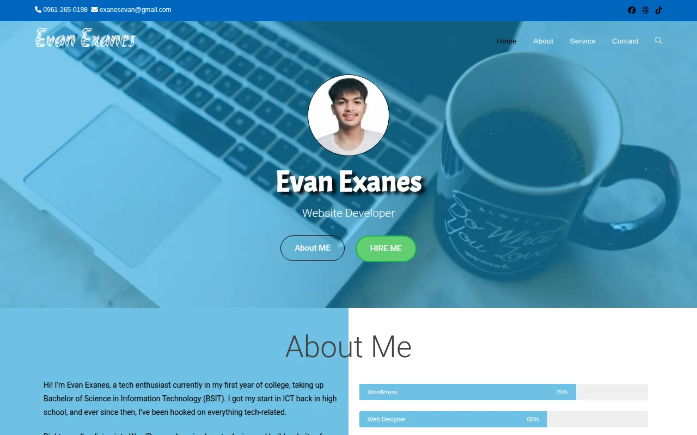

# Personal website

**A one-page personal site with a Hire Me popup form, built in WordPress in June 2025.**

## What this shows
- A one-page layout from June 2025 in Elementor and OceanWP, with a Hire Me popup form made in Popup Maker.
- A self-initiated practice build.
- The Hire Me form sends through Web3Forms in this static copy.

Lighthouse results for the live demo with mobile settings:

| Performance | Accessibility | Best practices | Largest contentful paint |
|---|---|---|---|
| 77 | 88 | 100 | 4.1 s |

Lighthouse 12.8.2, mobile settings with simulated throttling, run from a laptop on 10 November 2026. The SEO score is left out because these demo pages carry a `noindex` tag.

## Contents
- [What this shows](#what-this-shows)
- [About](#about)
- [Stack](#stack)
- [What this repository is](#what-this-repository-is)
- [What works in the static copy](#what-works-in-the-static-copy)
- [License](#license)
- [Author](#author)

## About
A one-page personal site from June 2025 with a Hire Me popup form. It is a self-initiated WordPress practice build.

## Stack

| Part | Tool |
|---|---|
| CMS | WordPress |
| Page builder | Elementor |
| Theme | OceanWP |
| Popup and forms | Popup Maker, Contact Form 7 |

## What this repository is
A static copy of the WordPress site, exported with Simply Static so it can run on GitHub Pages. It is generated HTML, CSS and JavaScript, not the WordPress source: there is no PHP, database or `wp-config.php` here.

Each exported page opens with a documentation header (program name, description, author and a history table). The files are generated, so they are not meant to be edited by hand: change the site in WordPress, export it again and add a history row. The page list, theme and plugins are in [docs/DOCUMENTATION.md](docs/DOCUMENTATION.md).

## What works in the static copy
GitHub Pages cannot run PHP, so anything that needs the WordPress server does not work in this copy. The Hire Me form sends through Web3Forms instead of Contact Form 7. Search needs WordPress and says so when used.

## License
WordPress, the theme and the plugins are each released under the GNU General Public License, version 2 or later or version 3, as each one states. This repository as a whole is released under the [GNU General Public License, version 3](LICENSE), which all of them allow. The sample text and pictures are placeholder content for a practice build.

## Author
**Evan Prens P. Exanes** · [GitHub](https://github.com/evanexanes) · [Portfolio](https://evanexanes.github.io/) · [Contact](https://evanexanes.github.io/07-contact.html)
